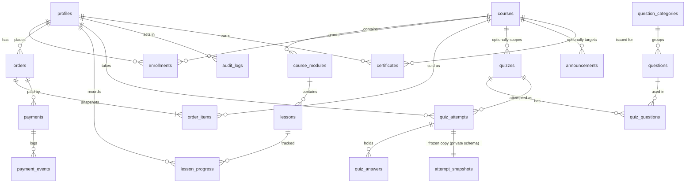

# Entity relationship diagram

Source of truth is `supabase/migrations/0001_schema.sql`. Amounts are integer BDT. All primary keys are UUIDs.

## Notes
- `private.attempt_snapshots` stores the exam as it was when the attempt started (including the answer key). It lives in the `private` schema, which API roles cannot use.
- `private.app_settings` holds `require_admin_mfa` (default `true`).
- `order_items` are immutable snapshots of title and price at purchase time.
- Courses, lessons, orders and questions that have history cannot be deleted (trigger `archive_instead_of_delete`); archive or unpublish instead.
- `audit_logs` is append-only (trigger blocks UPDATE/DELETE, even for the table owner).
